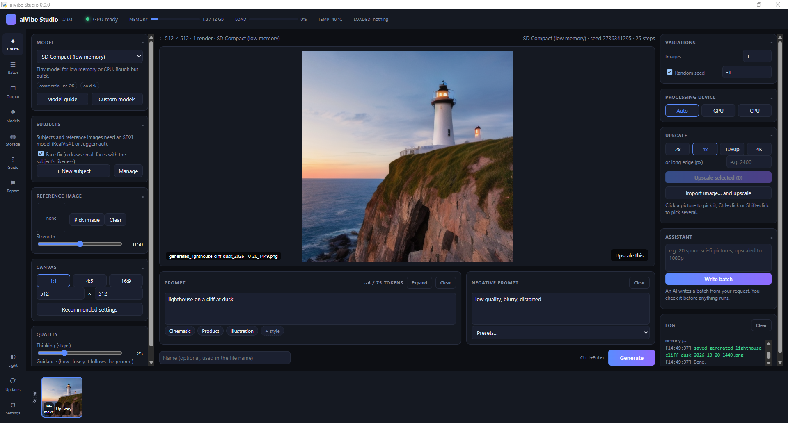

# aiVibe Studio

A local AI image studio for Windows PCs with an NVIDIA graphics card. Everything runs on your own PC: no account, no subscription, no cloud unless you choose the optional assistant.

Made in collaboration with AI agents (Claude and Gemini) and a human.

## What it does

- **Make pictures** from a text prompt with 12 well-known open models (Stable Diffusion 3.5, FLUX, RealVisXL, Z-Image and more). It has aspect presets, style chips, a negative prompt, seeds and the recommended settings for each model.
- **Batches:** load a `.txt` (one prompt per line) or `.json` file and walk away. Every picture is saved with a recipe file beside it, so you can make it again.
- **Upscale** any picture, yours or generated, to 2x, 4x, 1080p, 4K or an exact size, with Real-ESRGAN.
- **Train your own subjects:** people, pets, a car. Pick at least 5 photos (15 to 30 works best), press Train, and use them by name in prompts ("Alex hiking at sunset"), up to three in one picture. Click a face in a finished picture to redraw it as one of your subjects.
- **Assistant (optional):** describe what you want ("20 space sci-fi pictures, upscaled to 1080p"). Claude, Gemini, OpenAI or Grok writes the batch with your own API key, you check every line, and nothing runs until you press Go. Only your typed text is sent, never pictures or photos.

## Requirements

- Windows 10 or 11, 64-bit.
- An NVIDIA RTX graphics card, 20-series or newer, with 8 GB of video memory. 12 GB is recommended and is needed to train subjects. GTX 16-series and older cards are not supported (they produce black pictures). Without an NVIDIA card the app still runs, very slowly, on the CPU.
- An NVIDIA driver version 560 or newer.
- 16 GB of RAM.
- About 15 GB free for the app's Python environment, plus room for the models you choose (2 to 34 GB each).
- An internet connection for the first setup and for model downloads.

## Install

1. Download `aiVibeStudio-Setup-<version>.exe` from [Releases](https://github.com/carbonPrompt/aivibe-studio/releases).
2. Run it. The installer is not code-signed (a signing certificate needs a legal identity), so Windows SmartScreen may say "Windows protected your PC". Click **More info**, then **Run anyway**.
3. The installer needs no admin rights. After copying the app it downloads Python and the AI libraries (about 3 to 5 GB). This can take 10 to 30 minutes on a slow connection.
4. Start **aiVibe Studio** from the desktop or the Start menu. Pick a model; the first time, it downloads after you confirm.

If the setup step is interrupted, run **Repair aiVibe Studio** from the Start menu. The details are in `%LOCALAPPDATA%\aiVibe Studio\data\logs\setup.log`.

## Models and licenses

The models are not part of this project. Each one downloads from Hugging Face when you first pick it, under its own license, which the download dialog shows. Read the model card before using pictures commercially.

| Model | Size | License class | Needs a Hugging Face token | Video memory |
|---|---|---|---|---|
| Stable Diffusion 3.5 Large | 25.7 GB | conditions | yes | 11 GB |
| SD 3.5 Large Turbo | 25.7 GB | conditions | yes | 11 GB |
| Stable Diffusion 3.5 Medium | 16.0 GB | conditions | yes | 8 GB |
| Juggernaut XL V10 | 12.9 GB | non-commercial | no | 8 GB |
| RealVisXL V5.0 | 6.5 GB | commercial OK | no | 8 GB |
| DreamShaper 8 | 2.6 GB | commercial OK | no | 4 GB |
| Playground v2.5 | 7.0 GB | conditions | no | 8 GB |
| Stable Diffusion 1.5 | 2.6 GB | commercial OK | no | 4 GB |
| FLUX.1 Schnell | 34.0 GB | commercial OK | yes | 12 GB |
| SD Compact (low memory) | 1.8 GB | commercial OK | no | 4 GB |
| Z-Image Turbo | 31.0 GB | commercial OK | no | 12 GB |
| FLUX.2 klein 4B | 16.0 GB | commercial OK | no | 10 GB |

"Conditions" means the model is free for personal use and commercial use has terms (for example a revenue limit). Some models need a free Hugging Face account to download:

1. Make an account at huggingface.co.
2. Open the model's page and accept its terms.
3. Make a **Read** token (Settings, Access Tokens) and paste it in aiVibe Studio under **Settings, Hugging Face**.

The token is stored encrypted for your Windows user and only sent to Hugging Face. You can also add any diffusers model from Hugging Face, or a `.safetensors` file, in **Models**.

## Network use

aiVibe Studio connects to the internet only for:

- the first setup and Repair (Python from the python-build-standalone releases on GitHub, PyTorch from download.pytorch.org, the pinned libraries from PyPI);
- model downloads you confirm (Hugging Face);
- helper models the first time you use the feature that needs them: the upscaler (Real-ESRGAN) on your first upscale and the reference-image adapter (IP-Adapter) the first time you add a reference picture (Hugging Face);
- the update check: one request to the GitHub releases of this project when the app starts (Settings, Advanced can turn it off) and when you press Updates;
- the assistant, only when you use it, to the AI provider you chose.

There is no telemetry, no analytics and no account.

## Privacy

Your pictures, your subjects' photos and the trained subjects stay on your PC. Pictures go to `Pictures\aiVibe Studio\<date>\` unless you choose another folder. Settings, subjects, keys and downloaded models live in `%LOCALAPPDATA%\aiVibe Studio\`. Problem reports (the flag button) are saved locally; nothing is uploaded.

## Updates

The app checks for a new version when it starts and tells you in the log. Press **Updates** on the left to see what is new and install it. Nothing installs by itself. An update keeps your pictures, subjects, settings and models. The app only runs an installer from this project's releases whose checksum matches the one GitHub publishes.

## Uninstall

Use **Uninstall aiVibe Studio** in the Start menu, or Windows Settings, Apps. It asks whether to also delete your settings, trained subjects and downloaded models (default: keep them). Your pictures are never deleted.

## Building from source

The app is Python (pywebview + diffusers) with a plain HTML/JS window. Tests run anywhere with `python -m pytest`. The installer is built with Inno Setup 6 from `installer/aivibe.iss`; `installer/build.sh` shows the steps.

## License

MIT, see [LICENSE](LICENSE). Third-party code and model licenses are listed in [NOTICE](NOTICE).
